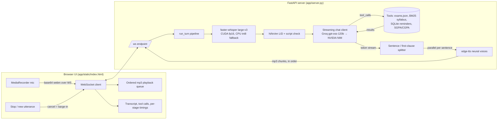

# VTU Saathi: a Hindi / Kannada / English voice study assistant

A local voice agent for VTU engineering students. You speak a question in Hindi, Kannada or English
(code-mixed is fine). The agent transcribes it, works out the language, calls real local tools
(exam timetable, syllabus search, reminders, SGPA/CGPA calculator) and speaks the answer back in
the same language. Tokens are streamed, and speech synthesis starts on the first sentence or clause.

```
mic (browser) ──webm──▶ faster-whisper large-v3 (RTX 4060, fp16)
                         └─ language ID restricted to hi/kn/en + script check
               ──text──▶ Groq gpt-oss-120b (streaming, OpenAI tool calling)
                         ├─ get_exam_schedule / search_syllabus (BM25) / set_reminder (SQLite)
                         ├─ calculate_sgpa / calculate_cgpa (VTU credit formula)
                         └─ falls back to NVIDIA NIM gpt-oss-20b on 429/5xx (30 s circuit breaker)
               ──first sentence/clause──▶ edge-tts neural voice (hi/kn/en-IN) ──mp3──▶ browser plays it
```

## Architecture



Why this stack (checked on this machine, Windows 11 + RTX 4060 8 GB):
- **STT: faster-whisper `large-v3` on CUDA.** The STT benchmark below compares `small`, `large-v3-turbo` and `large-v3`.
  Turbo and large-v3 score the same on Hindi, but turbo is much worse on Kannada (it sends almost every Kannada clip to Hindi),
  so the default is `large-v3`. CTranslate2 needed the `nvidia-cublas-cu12` and `nvidia-cudnn-cu12` wheels, and their DLL
  folders get registered at import (`app/stt.py`). If CUDA fails, the code falls back to CPU int8.
- **LLM: Groq `openai/gpt-oss-120b`** with `reasoning_effort=low`. Groq retired the Llama-3.3 models (the `/models`
  listing on 2026-10-04 has only gpt-oss and qwen chat models), and NVIDIA NIM returned HTTP 410 for `meta/llama-3.3-70b-instruct`.
  The fallback is NVIDIA NIM `openai/gpt-oss-20b`.
- **TTS: edge-tts** with `hi-IN-SwaraNeural`, `kn-IN-SapnaNeural` and `en-IN-NeerjaNeural` (the Madhur, Gagan and Prabhat voices are used in the eval).
- **No Pipecat.** A plain FastAPI + WebSocket pipeline is easier to read and to time per stage on Windows. The brief allowed this.

## Setup

```bash
# Python 3.13 with CUDA torch at C:/Python313 (system-site-packages reuses faster-whisper, fastapi, etc.)
C:/Python313/python.exe -m venv --system-site-packages .venv
.venv/Scripts/python.exe -m pip install edge-tts jiwer python-multipart nvidia-cublas-cu12 "nvidia-cudnn-cu12==9.*"
export HF_HOME=D:/hf-cache          # whisper weights (~3 GB for large-v3) are downloaded to D:/hf-cache/whisper
# API keys: put GROQ_API_KEY / NVIDIA_API_KEY in ./.env (gitignored). app/config.py also reads them from the
# owner's other local .env files. Key values are never printed or logged.

.venv/Scripts/python.exe -m uvicorn app.server:app --host 127.0.0.1 --port 8765
# open http://127.0.0.1:8765, press the mic, ask e.g. "ಕಂಪ್ಯೂಟರ್ ನೆಟ್‌ವರ್ಕ್ಸ್ ಪರೀಕ್ಷೆ ಯಾವಾಗ?"
```

Environment knobs: `WHISPER_MODEL` (default `large-v3`), `WHISPER_DEVICE` (`cuda`/`cpu`), `GROQ_MODEL_VOICE`,
`NVIDIA_MODEL_VOICE`, `VOICE_REASONING_EFFORT`.

## Tests and eval

```bash
.venv/Scripts/python.exe -m pytest -q                       # unit + pipeline (mocked LLM/TTS) + WS server + LLM client
.venv/Scripts/python.exe eval/make_audio.py                 # 42 clips via edge-tts, 2 voices/lang, 1 in 3 with 15 dB noise
.venv/Scripts/python.exe eval/stt_bench.py small large-v3-turbo large-v3   # WER/CER/LID per language
.venv/Scripts/python.exe eval/stt_bench.py large-v3 large-v3-turbo --forced
.venv/Scripts/python.exe eval/run_eval.py --mode audio      # full voice pipeline, auto language detection
.venv/Scripts/python.exe eval/run_eval.py --mode audio --pin  # language chosen in the UI dropdown
.venv/Scripts/python.exe eval/run_eval.py --mode text       # reference transcript -> LLM (separates out STT errors)
.venv/Scripts/python.exe scripts/e2e_browser.py             # Playwright + Chromium fake mic, hi/kn/en (server must be running)
.venv/Scripts/python.exe eval/report.py                     # -> eval/results/RESULTS.md
```

Metrics:
- **WER/CER**: jiwer on NFC-normalised text, with punctuation and ZWJ/ZWNJ removed.
- **Tool accuracy**: the expected tool was called. For chit-chat cases, no tool was called.
- **Answer accuracy**: rule checks. The tool must resolve to the right course or exam, the reminder time must be correct,
  and the required facts (date, module number, SGPA value, ...) must appear in the reply.
- **Latency**: p50/p95 per stage. STT. LLM time-to-first-token, measured from LLM start and including the tool round trip.
  TTS first audio byte. End-to-end, measured from receiving the audio to the first synthesized audio being ready to send.

## Results

<!-- RESULTS:START -->
Full tables: [eval/results/RESULTS.md](eval/results/RESULTS.md), generated from the JSON files and never edited by hand.
Headline numbers (42 utterances, measured 2026-10-04 on an RTX 4060 laptop):

42 scripted utterances (14 hi, 14 kn, 14 en), synthesized with edge-tts using 2 voices per language; every 3rd clip has white noise at 15 dB SNR. Eval date pinned to 2026-10-04 10:00 for reminders.

## STT model comparison (faster-whisper, RTX 4060, float16)

| model | lang mode | hi WER | hi CER | kn WER | kn CER | en WER | en CER | kn LID acc | STT p50 ms (hi/kn/en) |
|---|---|---|---|---|---|---|---|---|---|
| small | auto-detect | 55.2% | 31.1% | 107.9% | 99.5% | 4.6% | 1.4% | 57.1% | 1043/1532/455 |
| large-v3-turbo | auto-detect | 24.0% | 18.8% | 106.1% | 88.3% | 3.9% | 1.3% | 0.0% | 815/828/722 |
| large-v3 | auto-detect | 24.0% | 18.8% | 83.3% | 46.7% | 2.6% | 1.1% | 64.3% | 2114/2635/1165 |
| large-v3 | forced | 24.0% | 18.8% | 69.3% | 27.6% | 2.6% | 1.1% | 100.0% | 1732/2551/798 |
| large-v3-turbo | forced | 24.0% | 18.8% | 89.5% | 53.9% | 3.9% | 1.3% | 100.0% | 627/731/503 |

## End-to-end: eval_audio.json

### `audio` — n=42, STT=large-v3 (cuda), LLM=nvidia, run 2026-10-04 12:56:48

| lang | n | WER | CER | detected-lang acc | tool acc | answer acc | reply-in-lang | errors |
|---|---|---|---|---|---|---|---|---|
| hi | 14 | 24.0% | 18.8% | 100.0% | 92.9% | 78.6% | 100.0% | 0 |
| kn | 14 | 84.2% | 46.2% | 64.3% | 92.9% | 57.1% | 57.1% | 0 |
| en | 14 | 2.6% | 1.1% | 100.0% | 92.9% | 92.9% | 100.0% | 0 |
| **all** | 42 | 32.5% | 22.1% | 88.1% | 92.9% | 76.2% | 85.7% | 0 |

| lang | STT p50/p95 ms | LLM TTFT p50/p95 ms | TTS first audio p50/p95 ms | **E2E to first audio p50/p95 ms** | total turn p50/p95 ms |
|---|---|---|---|---|---|
| hi | 2256 / 3248 | 3067 / 4421 | 1412 / 1872 | 8722 / 9628 | 9145 / 9780 |
| kn | 3027 / 10521 | 4032 / 5166 | 1663 / 3256 | 10083 / 29778 | 10506 / 29778 |
| en | 1348 / 1971 | 3514 / 6045 | 1014 / 2115 | 7532 / 10971 | 8039 / 11182 |
| **all** | 1949 / 4028 | 3617 / 5706 | 1407 / 2544 | 8544 / 12330 | 9383 / 20246 |

## End-to-end: eval_audio_pinned.json

### `audio_pinned` — n=42, STT=large-v3 (cuda), LLM=groq,nvidia, run 2026-10-04 12:28:01

| lang | n | WER | CER | detected-lang acc | tool acc | answer acc | reply-in-lang | errors |
|---|---|---|---|---|---|---|---|---|
| hi | 14 | 24.0% | 18.8% | 100.0% | 100.0% | 85.7% | 100.0% | 0 |
| kn | 14 | 72.8% | 28.1% | 100.0% | 92.9% | 64.3% | 85.7% | 0 |
| en | 14 | 2.6% | 1.1% | 100.0% | 92.9% | 92.9% | 100.0% | 0 |
| **all** | 42 | 29.4% | 16.0% | 100.0% | 95.2% | 81.0% | 95.2% | 0 |

| lang | STT p50/p95 ms | LLM TTFT p50/p95 ms | TTS first audio p50/p95 ms | **E2E to first audio p50/p95 ms** | total turn p50/p95 ms |
|---|---|---|---|---|---|
| hi | 1962 / 3366 | 3199 / 5970 | 1255 / 2017 | 7903 / 11086 | 8319 / 11086 |
| kn | 3051 / 11547 | 3461 / 4812 | 1864 / 2615 | 10311 / 17256 | 10577 / 17871 |
| en | 1091 / 1675 | 3188 / 6451 | 960 / 1444 | 6103 / 14752 | 6392 / 14752 |
| **all** | 1893 / 4470 | 3253 / 5904 | 1170 / 2402 | 8032 / 14006 | 8431 / 14006 |

## End-to-end: eval_text.json

### `text` — n=42, STT=None (None), LLM=nvidia, run 2026-10-04 12:34:02

| lang | n | WER | CER | detected-lang acc | tool acc | answer acc | reply-in-lang | errors |
|---|---|---|---|---|---|---|---|---|
| hi | 14 | – | – | 100.0% | 100.0% | 85.7% | 92.9% | 0 |
| kn | 14 | – | – | 92.9% | 85.7% | 78.6% | 64.3% | 1 |
| en | 14 | – | – | 100.0% | 100.0% | 100.0% | 100.0% | 0 |
| **all** | 42 | – | – | 97.6% | 95.2% | 88.1% | 85.7% | 1 |

| lang | STT p50/p95 ms | LLM TTFT p50/p95 ms | TTS first audio p50/p95 ms | **E2E to first audio p50/p95 ms** | total turn p50/p95 ms |
|---|---|---|---|---|---|
| hi | 0 / 0 | 3434 / 5216 | 1748 / 2524 | 7490 / 11022 | 8291 / 11759 |
| kn | 0 / 0 | 3699 / 4986 | 1621 / 2513 | 7045 / 12578 | 7244 / 14206 |
| en | 0 / 0 | 3237 / 4504 | 1231 / 2204 | 5589 / 7909 | 5918 / 9045 |
| **all** | 0 / 0 | 3260 / 5216 | 1591 / 2364 | 6342 / 10161 | 7045 / 11295 |

## Browser E2E (Playwright, Chromium fake microphone)

| lang | transcript | detected | tool | audio clips played | E2E first audio ms |
|---|---|---|---|---|---|
| hi | मेरा कम्प्यूटर नेटवर्क्स का एकजाम कब है? | hi | get_exam_schedule | 2 | 10823 |
| kn | ನಾನೆ ಸಂಜೆ ಆರು ಗಂಟಗೆ ಕಮ್ಪ್ಯೂಟರ್ ನೇಟ್ವರ್ಕ್ಸ್ ಓದಲು ನಿನಪಿಸು. | kn | set_reminder | 1 | 12436 |
| en | Which module of computer networks covers TCP congestion control? | en | search_syllabus | 1 | 14094 |

<!-- RESULTS:END -->

## Limitations (honest)

- **Kannada STT is the weak link.** Whisper large-v3 on synthetic Kannada speech still has high WER (see the table).
  Code-mixed technical words get transliterated phonetically, and with auto-detect some Kannada clips are labelled
  Hindi or English, so the reply comes back in the wrong language. Picking the language in the UI dropdown (`--pin` eval)
  fixes the language choice but not the WER. An Indic-specific ASR model (AI4Bharat IndicConformer, or a
  Kannada fine-tune of Whisper) would be the next step. It is not done here.
- **The eval audio is synthetic.** It is edge-tts speech plus white noise, not real students on laptop mics, so real-world
  WER will be worse. The TTS voices used for the test clips come from the same family as the reply voices.
- **Latency depends on free-tier cloud services.** Groq free tier rate limits (HTTP 429) are shared with other projects
  on the same key. When Groq is rate-limited the client fails over to NVIDIA NIM straight away and skips Groq for 30 s.
  edge-tts needs internet. End-to-end time to first audio is several seconds, not sub-second, mostly because of the
  two LLM round trips (tool decision, then answer) and large-v3 STT time.
- **Which LLM served the eval runs.** During the eval runs, Groq gpt-oss-120b had used up its free
  **200k tokens/day** quota (HTTP 429 TPD), so 125 of the 126 eval turns went to the NVIDIA NIM `gpt-oss-20b` fallback (each table
  lists the providers used). Accuracy with gpt-oss-120b on every turn was not measured.
- **"E2E to first audio" waits for a full clip.** It is the time until the first sentence or clause has been fully
  synthesized and is ready to send. Clips are mp3 per sentence, not byte-streamed, so the true time to first sound is
  roughly `tts_first_clip_s - tts_first_audio_s` lower.
- **Barge-in is button- or utterance-based, not VAD-based.** Pressing Stop or starting a new recording cancels the server
  task and stops local playback. The server-side cancel is covered by a test. The server does not listen to the mic while
  it is speaking (no full-duplex VAD).
- **The demo data is made up.** `app/data/exams.json` and the syllabus notes were written for this demo. They are not an
  official VTU timetable or the full syllabus.
- **Reminders are only stored in SQLite.** No notification is fired when a reminder comes due.
- **Not deployed and no Docker image.** The project runs locally only.
